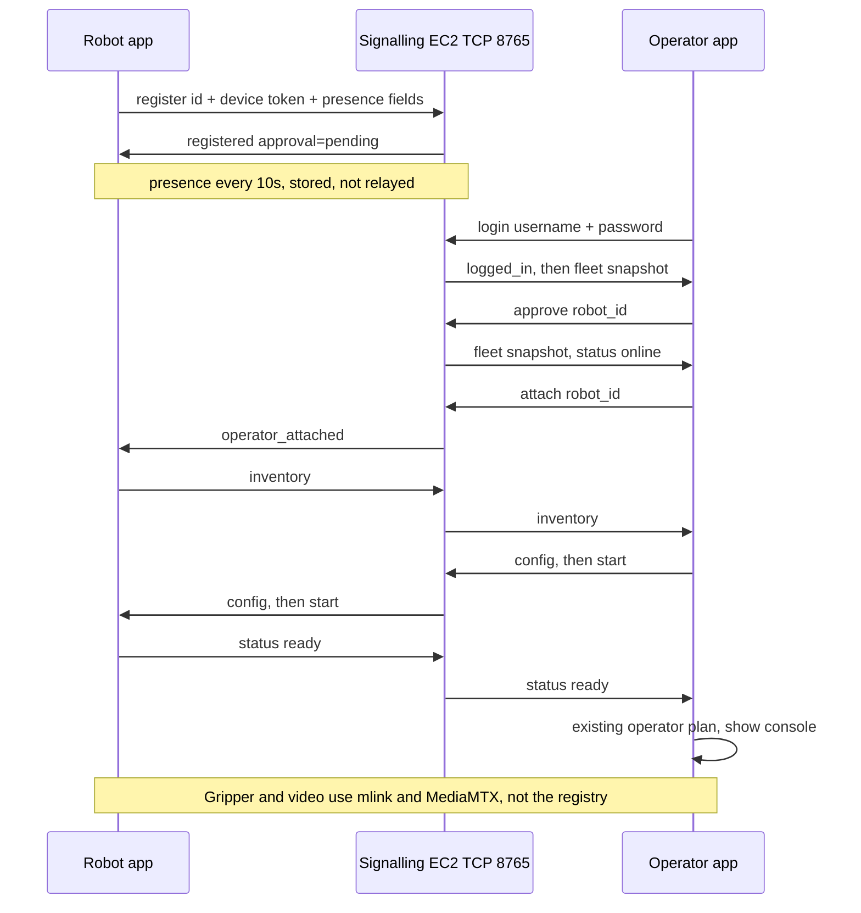

# Fleet architecture

| | |
| --- | --- |
| Author | placeholder |
| Date | 2026-10-07 |
| Status | Draft |
| Branch | `feature/fleet` at `81156a4`. Operator restructure is `2605cfb` (`feat: run the operator app as host Python`). |
| Supersedes | The single-robot login. The data plane stays mlink and MediaMTX. The operator UI is host Python. The robot app still runs in Docker. |

This file is the design for a fleet dashboard on the operator app. It does not implement that design. Root `IMPLEMENTATION.md` still marks "Fleet / hired operators" deferred. This slice is the dashboard half of that row (list, counts, pick one robot). It is not the hired-operator marketplace, and this document does not edit the roadmap.

---

## Overview

Today `teleop-operator` is one host Python process. It serves `http://127.0.0.1:8090/` itself and opens that page in a desktop window. It does not start Docker and it does not use the ROS image. Login and config are pages in that process. The person still logs in with one robot's 9-digit id and the password typed on that robot's SSH session. The registry in the TCP 8765 signalling process checks the password, attaches that one operator, and relays inventory, config, start, and stop. Nothing in that process remembers a robot after its socket closes, and the robot app calls `new_id()` on every launch.

The fleet slice replaces that login. The operator logs in with an operator username and password, sees a fleet dashboard of registered robots, and then attaches to one of them. The dashboard is another page in that same host process, between login and config. Config and the drive page stay as they are after that choice. The operator PC still has no Docker and no ROS image. The robot app still starts its container. The robot stops asking a person for a password. It keeps a stable id and a device token on disk, registers with a hash of that token, and pushes presence so the dashboard can show robots that nobody is driving. New robots stay pending until a logged-in operator approves them.

The registry is still the packaging registry inside `turn/signalling/server.py`. It gains a sqlite file on the EC2 host. Coturn is not touched. Gripper bytes and video do not move onto this path.

---

## Background and motivation

Packaging already ships two programs. The operator UI is host Python. The robot stack is still Docker.

| Piece | Where it lives | What it does now |
| --- | --- | --- |
| Robot terminal | `packaging/robot_app/cli.py` `launch` | Calls `new_id()` from `packaging/robot_app/credentials.py`, prompts twice with `getpass`, builds `RobotState`, runs `run_robot_session`. Start still brings up the robot container. |
| Operator process | `packaging/operator_app/host.py` `OperatorHost` | One process serves the pages, holds the registry socket, and, after Start, sends mlink UDP. `/` is login, `/config` is config, `/operate` is the drive page. No operator container and no ROS node. Login still sends the robot id and password. |
| Registry | `packaging/registry/session.py` `Registry` | In-memory `sessions: dict[str, Session]`. `hash_password` / `password_matches` use PBKDF2-HMAC-SHA256, 16-byte salt, 32-byte digest, `_ITERATIONS = 20_000`, and `hmac.compare_digest`. |
| Router | `turn/signalling/server.py` `Hub.handle` | First message `register` or `login` is handed to `Registry.handle` and that socket leaves the ICE loop. First message `join` stays an ICE room. |

The manager asked for hundreds of robots and a dashboard: how many are autonomous, how many need a person, and a way to pick one robot to drive. The current login cannot do that. The operator has to already know the id and the password, the registry forgets a robot when the robot socket drops (`Registry._drop` pops the session), and inventory is sent only inside `_hold` after `operator_attached`. A dashboard has nothing to list before someone attaches.

Two facts in the code constrain the robot change:

- `launch` assigns `robot_id = new_id()` and never reads a saved id. A restart is a new robot. `607045244` does not appear anywhere in the tree. It is not a hardcoded lab id. If that number is still written on a whiteboard, it was one draw of `secrets.choice` and it dies with the process.
- `credentials.py` does not store the password. `n` in `command_for` calls `apply_new_password`, which bumps `RobotState._revision` and re-registers. The id is stable only until exit.

`status_message` in `packaging/supervisor/robot_commands.py` only allows phases `starting`, `ready`, `stopped`, and `error`. There is no mode flag, no autonomous switch, and no planner.

---

## Goals and non-goals

### Goals

- Operator login is a username and password. After login the host process shows the fleet dashboard, then the existing config page and `/operate`.
- A robot has a stable public id and a secret device token. EC2 stores only the hash. A person at the SSH session does not type a password.
- The registry remembers approval and the latest presence across a signalling restart, and it can list robots with no operator attached.
- One live socket per username, and that socket drives one robot. A second driver is a second account. One robot has one operator. Pending robots cannot be operated.
- The first lab picture is two `teleop-robot` processes: one reporting `manual` on the SO-ARM host, one reporting `autonomous`. Autonomy is a reported label.
- Stay on TCP 8765 in the existing signalling process. Session JSON stays `"v": 1`.

### Out of scope

- Hired-operator marketplace, billing, multi-tenant orgs, SOC2, IEC certification
- An admin role on the dashboard. Any logged-in operator may approve. Accounts are created on the EC2 host, not on the page.
- Rewriting `operate.js`, the ROS motion stack, mlink, or the camera path
- Video-through-mlink, joints 1–5, MoveIt, a mission executive, or any real autonomy stack
- A new EC2 port or a third EC2 service
- A robot Qt UI. `packaging/robot_app/` has no window module.
- TLS on the registry. Packaging left that out of P1–P8. This slice does not add it.
- GPS, a map, or a location service
- Revoking an approval from the dashboard, rotating a device token in the protocol, or un-approving a robot from the page
- Editing root `IMPLEMENTATION.md`, and implementing this design in the session that writes it
- Interface 2 bonding, TURN milestones T7–T10, and the paused safety rows

---

## Proposed design

### What does not change

- mlink. Tailscale is still `start_daemon.sh` with `--remote-laptop`. TURN is still `--ice`. Never both. Generated ICE yaml still refuses a `100.` `bind_ip`.
- The camera. MediaMTX on the robot, page from inventory `camera_page`. `listen_media` stays unset.
- The gripper path. The host process on `127.0.0.1:8090` sends UDP to mlink on `127.0.0.1:5501/5502` and `5503/5504`. Keys `g` and `h` stay in the drive page. The one-notch gripper step already on this branch stays as it is.
- Coturn. UDP 3478 and relay UDP 50000–50100. No listener on 3479, no listener in the relay range, no TCP 8766.
- The drive page. `/operate` still serves `index.html` and `operate.js`. This slice does not rewrite `operate.js`. App launch starts `OperatorHost` and opens the desktop window. It does not start Docker. mlink still starts only on Start. Heartbeats stay off until mlink-op is up.
- One username has one live socket, and that socket drives one robot at a time. The shared lab account cannot open a second browser and drive a second robot. The dashboard is how the one robot is chosen. A second driver is a second account.
- Stop and the torque-off order. mlink down first, then the robot stop plan, so the 500 ms watchdog releases the gripper before the robot container, mlink-edge, and the camera stop. The stop wait stays 30 seconds. Stop leaves the operator process running. There is no operator container to stop.
- A registry disconnect after `ready` does not stop an arm that has already started. Explicit Stop, Release, Sign out, or Quit does. Quit and closing the desktop window stop mlink, then the robot, then the operator process.
- Attach-time messages, once a robot is selected: `inventory`, `config`, `config_ok`, `bad_config`, `start`, `stop`, `status`, `operator_attached`, `operator_detached`.
- ICE `join` / `candidates`. Those frames still have no `v`. The first-message test in `Hub.handle` stays `type in ("register", "login")`.
- Python on EC2. Registry code stays importable on Python 3.9 (`from __future__ import annotations`, no `match`, no `isinstance(x, str | None)`). No new pip dependency. `sqlite3` and `hashlib` are stdlib. `websockets` is already installed for signalling.
- Debian layout. `copy_common` in `packaging/debian/build.sh` already rsyncs `packaging/registry/` and `packaging/robot_app/` into both debs, and the operator payload adds `packaging/operator_app/`. New modules under those trees ship without a packaging-script change. The sqlite file and the robot token file are not in the deb.

```text
OPERATOR PC                                  ROBOT PC
teleop-operator is host Python               teleop-robot, still Docker
  window: http://127.0.0.1:8090/               no password prompt
  /        login                               id printed, token stays in a 0600 file
  /fleet   dashboard                           presence every 10 s
  /config  existing config page                inventory only after operator_attached
  /operate drive page after Start              robot container starts on Start
        |                                          |
        +---- TCP 8765, same process -------------+
              register / login / fleet JSON
              no gripper bytes, no video

After Start, unchanged:

  mlink-op  <-- Tailscale or TURN (coturn UDP) -->  mlink-edge
  MediaMTX page stays on the robot
```



### Counts

Each known robot is in exactly one class. The class decides the counts. A robot is never in two of autonomous, needs manual, and in teleop.

| Class | Rule |
| --- | --- |
| `pending` | Not approved. In the table. In none of the four counts. |
| `offline` | Approved, and either the robot socket is not current, or the socket is current, nobody is held, and `last_seen` is a timestamp older than 30 s. A missing `last_seen` is not this row. |
| `in_teleop` | Approved, the robot socket is current, and an operator is attached or a start is in progress. A held robot whose presence is stale stays here until `release` finishes, so `stop` can still be forwarded. Its status label is `stale`, not `running` and not `offline`. |
| `autonomous` | Approved, socket current, not held, not stale, `mode == "autonomous"`. |
| `needs_manual` | Approved, socket current, not held, not stale, mode is `manual` or anything else. |

| Count | Definition |
| --- | --- |
| `registered` | Approved robots. `autonomous + needs_manual + in_teleop + offline`. Pending is not included. |
| `autonomous` | Class `autonomous`. |
| `needs_manual` | Class `needs_manual`. |
| `in_teleop` | Class `in_teleop`. |

Taking over an autonomous robot does not change its reported mode. The row still says mode `autonomous`. The class becomes `in_teleop`, so the autonomous count drops by one and the in-teleop count rises by one. Offline and pending stay visible in the table and stay out of autonomous and needs manual.

`start_in_progress` is set when the registry forwards `start`, and cleared on `status` phase `ready`, `stopped`, or `error`, on `operator_detached`, on a current-socket drop, and when the stale sweep below clears a hold. While the robot is online, an attached operator is enough to count as in teleop, including the config page before Start and the config page after Stop. The start flag covers those same online robots so a later edit cannot count a starting robot as needs-manual.

Reported phase cannot move a robot into `in_teleop` by itself. A robot that sends `phase: ready` with nobody attached stays `autonomous` or `needs_manual`.

```python
def robot_class(robot: RobotView) -> str:
    if robot.approval != "approved":
        return "pending"
    if robot.robot_ws is None:
        return "offline"
    if robot.operator is not None or robot.start_in_progress:
        return "in_teleop"
    if robot.last_seen is not None and robot.age_s >= 30:
        return "offline"
    if robot.mode == "autonomous":
        return "autonomous"
    return "needs_manual"
```

`last_seen` is the server clock at the last token `register` or `presence`. The robot does not send a timestamp. A missing `last_seen` is not stale. The compare must not treat `None` as older than 30 seconds and must not raise. Closing the current socket clears it immediately and takes the drop path, which is not this sweep.

`Registry._maintain` is one asyncio task, started once from the first `handle` call via `asyncio.get_running_loop().create_task`. It wakes every 1 second. It reloads operator rows and the sqlite robot-id set, as specified under accounts. Stale and delete checks apply only to robot ids that were loaded from sqlite. An in-memory password session is not in that set. The task does not close it, does not mark it stale, and does not send it `fleet` or `offline`.

For a sqlite robot whose `robot_ws` is still set and whose `last_seen` is a timestamp older than 30 seconds, one transition:

| Held? | What the sweep does |
| --- | --- |
| No | Mark the row offline for the counts and the status column. Push `fleet` to username-login sockets only. Do not send `stop`. Do not send `stale`. Do not close the socket. Do not delete the row. |
| Yes | Do not clear the hold and do not send `operator_detached` yet. `stop` must still be forwardable. Send `{"v":1,"type":"error","code":"stale"}` to that operator socket. Do not send `offline`. Status becomes `stale`. Class stays `in_teleop`. Arm a 30 second timer, the same wait `ConsoleApp` uses for stop. |

While that timer runs, a `stop` from the operator is forwarded like any other `stop`. If `status` phase `stopped` arrives first, cancel the timer. The page then sends `release`, and that release is the normal one. If `stopped` has not arrived when the timer fires, the registry forwards `{"v":1,"type":"stop"}` to the still-current robot socket, then clears the hold and sends `operator_detached`. It does not wait for another `stopped`, and it does not send `offline`. A later `release` from the same logged-in socket, after the hold is already clear, replies `released` and does not error. The sweep notifies once per transition. A later real `_drop` of that socket does not send a second `offline` if the operator pointer was already cleared. A later `presence` or token `register` on that same socket sets `last_seen`. If the hold is already gone and the stamp is fresh, the row is online again.

That 30 second sweep is the application timeout for a socket object that is still open. It is not the TCP timeout, and it is not the socket-dead path. `turn/signalling/server.py` calls `serve` with no ping arguments. The vendored default is `ping_interval=20` and `ping_timeout=20` (`packaging/debian/vendor/websockets/asyncio/server.py`). This slice does not change those arguments. A dead peer fails the ping and the library closes the socket in about 40 seconds, and that close takes `_drop`: code `offline`, hold cleared, no `stop` forwarded, because the robot socket is already gone. The page treats `stale` and `offline` as different events.

### Dashboard status and action

The status column is not the raw `status.phase` and it is not the count class. It is one label:

| Status | When |
| --- | --- |
| `pending` | Not approved. |
| `offline` | Approved, and either no current socket, or a current socket with nobody held and a `last_seen` older than 30 s. Not used while the socket is open and an operator is still attached. |
| `online` | Approved, socket current, not held, not stale. |
| `stale` | Approved, socket still current, operator still attached, and `last_seen` is a timestamp older than 30 s. The stop described below has not finished. |
| `attached` | Socket current, held, fresh, phase not `starting`, `ready`, or `error`. This includes the config page and phase `stopped`. |
| `starting` | Socket current, held, fresh, and `start_in_progress` or phase `starting`, and phase is not yet `ready` or `error`. |
| `running` | Socket current, held, fresh, and phase `ready`. |
| `error` | Socket current, held, fresh, and phase `error`. |

`running` requires a fresh `last_seen`. A held robot with a stale presence shows `stale` until `release`. After that release, if the presence is still old and nobody is held, the row becomes `offline`. A missing `last_seen` does not produce `stale`.

| Row | Action cell |
| --- | --- |
| `pending` | Approve |
| `online` | Operate, unless this socket already holds a robot |
| `offline` | empty |
| held by another username | In use, not a button |
| held by this socket | Release. The browser is on config or `/operate` in that case, not sitting on Operate. |

Operate on `pending` is not offered. The server answers `attach` of a pending robot with `pending` even if a client draws the button.

### 1. Operator app

The operator UI is `OperatorHost` in `packaging/operator_app/host.py`. Launch starts that one process and opens `http://127.0.0.1:8090/` in the desktop window (`packaging/operator_app/desktop.py`). The window is Qt WebEngine when that library is already installed, and a Chrome app window otherwise. The package does not depend on PyQt, Docker, or the ROS image. `ConsoleApp` holds the registry socket inside this process. A refresh reads `/api/session` and does not send `login` again. The password is not stored and is not logged. There is no operator container and no `operator_backend` process.

The fleet dashboard is the next page in that same process. It sits between login and config. The page is HTML, the same way `login.html` and `config.html` are.

```text
App start: host Python up, window opens http://127.0.0.1:8090/

Login  ->  Fleet dashboard  ->  Config  ->  Console (/operate)
                ^                  |              |
                |                  +---- Stop ----+
                +---------- Release --------------+
         Sign out returns to Login
```

| Path | View in `/api/session` | Page |
| --- | --- | --- |
| `/` | `login` | Existing `login.html`. Operator name and password. |
| `/fleet` | `fleet` | New `fleet.html` and `fleet.js`. Counts and the robot table. |
| `/config` | `config` | Existing `config.html`. Shown after a robot is selected. |
| `/operate` | `operate` | Existing `index.html` and `operate.js`. Shown only after Start. |

Login. The form stops asking for a robot id. The POST body to `/api/login` is `{"username","password"}`. `login_message` in `packaging/operator_app/login.py` becomes:

```json
{"v":1,"type":"login","username":"lab","password":"<operator-password>"}
```

The name field placeholder is `Operator`. The password field is cleared after a successful login. Empty submit says `Enter the operator name and password.` `interpret_login` treats `logged_in` as success and does not require `hostname`. `hostname` moves to the `attached` message, which the config page already shows. Wrong username, wrong password, a disabled account, and a username locked out after five failures are all `auth`. The form says `Wrong password.` for every one of those. `legacy_login` uses the unexpected-reply label. A second socket for a username that already has a live socket gets `already_attached` and the form says `This account is already signed in.` The registry socket stays open after `logged_in` and is not attached to a robot yet.

`OperatorSession.login` reads until `logged_in` or `error`. A `fleet` frame that arrives while it is waiting is stored on `ConsoleApp` and is not parsed as the login result. `/api/session` returns that snapshot. `fleet.js` polls `/api/session` the way `login.js` and `session_bar.js` already poll. The browser does not open TCP 8765. Dropping the snapshot, or feeding it to `interpret_login`, is a bug. After `logged_in`, `view` becomes `fleet` even when no snapshot has arrived yet. The table is empty and the status is `Waiting for the fleet.` The browser goes to `/fleet`. It does not open `/config` until Operate.

Dashboard and login strings, in the same style as the messages in `packaging/operator_app/login.py`:

| Code or event | Where it shows | Text |
| --- | --- | --- |
| empty submit | login form | `Enter the operator name and password.` |
| `auth`, including the fifth and later failure for that username | login form | `Wrong password.` |
| `already_attached` on `login` | login form | `This account is already signed in.` |
| `legacy_login`, and any other login `error` | login form | `The registry sent an unexpected reply.` |
| socket closed with no registry frame | login form | `Cannot reach the registry.` This is today's `unreachable` path in `OperatorSession.login`. It is not the guessing limit. |
| `not_found` | dashboard status line | `That robot is not registered.` |
| `pending` | dashboard status line | `That robot is not approved.` |
| `offline` on `attach`, or `offline` because the robot socket dropped | dashboard status line | `That robot is offline.` |
| `stale` while this socket is attached | dashboard status line, then the stop below | `The robot is not answering. Stopping the arm.` |
| `busy` | dashboard status line | `Another operator is already connected.` |
| `already_attached` on `attach` | dashboard status line | `This account is already operating a robot.` |

The robot SSH line does not get new sentences. `interpret` already copies an error `code` into the status token, and `status_line` prints `ID <id>  status <code>`. That covers `full`, `bad_field`, `legacy_robot`, `auth`, and `bad_id`.

Dashboard. New files `teleoperation-prototype/web/fleet.html` and `fleet.js`, served by `OperatorHost` at `/fleet`. Colors come from `operate.css`. It is a page in the host process, the same way `login.html` and `config.html` are. It is not a second process and not a Qt form.

| Element | Contents |
| --- | --- |
| Counts | The four integers from the latest `fleet` message: registered, autonomous, needs manual, in teleop. |
| Table | Columns: ID, Location, Status, Mode, Action. Rows sorted by `robot_id`. |
| Sign out | Shown on the session bar. Stop and Release are hidden on this page. |

`ConsoleApp` stores every `fleet` message, including while config or `/operate` is showing. `/api/session` includes the latest counts and rows. `fleet.js` paints the table only while the path is `/fleet`. The poll interval matches `session_bar.js` (300 ms). A `logged_in` with no fleet yet shows an empty table and the status `Waiting for the fleet.`

Approve is `POST /api/approve` with `{"robot_id":"<id>"}`. The backend sends `{"v":1,"type":"approve","robot_id":"<id>"}`. Operate is `POST /api/attach`. The backend sends `{"v":1,"type":"attach","robot_id":"<id>"}`. The page hides Operate while this session already holds a robot. The server still enforces that.

After `attached`, the page shows `Waiting for the robot.` When `inventory` arrives, `view` becomes `config` and the window opens `/config`. Review and Start stay the current path. Start calls the in-process helper for mlink only (`/mlink/start`). That plan must refuse `start_operator_mlink.sh`. After mlink-op is up, `OperatorHost.enable_link` opens UDP and arms heartbeats, then the window opens `/operate`. The operator process is already running. Do not start Docker on the operator PC.

Session bar, extending `session_bar.js`:

| Page | Stop | Release | Sign out | Quit |
| --- | --- | --- | --- | --- |
| Login | hidden | hidden | hidden | shown |
| Fleet dashboard | hidden | hidden | shown | shown |
| Config, `/operate` | shown | shown | shown | shown |

Stop. mlink down first, then `{"v":1,"type":"stop"}`, wait up to 30 seconds for phase `stopped`, show `/config`, keep the accepted config, the login, and the attachment. The operator process stays up. Start can run again.

Release. This replaces today's Logout as the way back to the robot list. If mlink is up or a start is in progress, run the same stop, then send `{"v":1,"type":"release"}`, wait for `released` up to 5 seconds, and show `/fleet`. Do not close the registry socket. Do not clear the operator login. If nothing has been started, send `release` only. The robot still gets `operator_detached`.

Sign out. From the dashboard, send `{"v":1,"type":"sign_out"}` and show `/`. From config or `/operate`, stop first if needed, then `sign_out`. The registry socket closes. The account row in sqlite is not deleted.

Quit. If a robot is held, stop mlink first and then the robot. Then the operator process exits. There is no `docker compose down` on the operator PC. Quit does not send `sign_out`. Closing the desktop window calls `/api/quit`, so it does the same stop. The robot container is stopped by that robot `stop`, not by an operator container command.

Two different failures while a robot is attached. They are not the same client event.

`stale`. The registry socket is still open. `ConsoleApp` does not treat this as a dead socket and does not skip the robot stop. It runs the same sequence as Release: stop mlink first, so the 500 ms watchdog torque-offs the gripper, then send `{"v":1,"type":"stop"}`, wait for phase `stopped` or 30 seconds, then send `release` and return to `/fleet` with the login held. The registry forwards that `stop` because the hold is still set. If `stopped` does not arrive in time, the registry forwards `stop` itself to the still-current robot socket, then clears the hold and sends `operator_detached`. The following `release` still gets `released`.

`offline`. The robot socket has dropped. `stop` cannot be forwarded. The backend stops only local mlink and returns to `/fleet` with the login held. It does not send `stop` or `release`. `/operate` must not stay up.

`parse_inbound` already accepts any `v: 1` object. `fleet`, `attached`, `released`, and `signed_out` pass that filter. `ConsoleApp` learns those types. The drive page does not.

The first lab picture on this page is two rows. One is the SO-ARM process, mode `manual`, status `online`, action Operate. One is the second `teleop-robot` process, mode `autonomous`, status `online`, action Operate. Counts for that picture, both approved and idle: registered 2, autonomous 1, needs manual 1, in teleop 0. Operating the manual robot moves the counts to registered 2, autonomous 1, needs manual 0, in teleop 1. The ids are whatever those hosts persisted. The software does not look for `607045244`.

### 2. EC2 service

This is the large change. The process, the port, and the first-message split stay. `Hub` still builds one `Registry`. `_new_registry` still returns `None` on `ImportError` so ICE `join` still runs if the packaging package is missing. If the sqlite file cannot be opened, `_new_registry` also returns `None` and logs the path. ICE keeps working. `register` and `login` then fall through to the ICE `unknown_type` error, which is the existing failure mode for a missing registry.

`start_server` is the test helper (`turn/tests/test_signalling.py`, `turn/tests/test_run.py`, `mlink-transport/tests/test_ice_path.py`, and the packaging tests). It keeps using an in-memory database so those call sites do not grow a new argument and do not create a file under the home directory. `_amain` (what `python3 -m signalling.server` runs on EC2) opens the durable file. mlink tests are not edited.

#### Durable file

| Item | Value |
| --- | --- |
| Path | See the three cases under this table. The usual EC2 file is `/home/ec2-user/.local/share/teleop/registry.sqlite`. |
| EC2 file | `/home/ec2-user/.local/share/teleop/registry.sqlite` |
| Directory mode | `0700` |
| File mode | `0600`, owner is the user that runs signalling |
| Why that path | `packaging/docs/P3_usage.md` rsyncs `packaging/` to `~/turn/packaging/` and `server.py` to `~/turn/signalling/server.py`. The database stays outside that tree so a later rsync does not replace it. |
| Tests | `start_server` uses `:memory:` unless `db_path=` is passed. Persistence tests pass a `tmp_path` file. |
| WAL | `PRAGMA journal_mode=WAL` and `PRAGMA synchronous=NORMAL` on the durable file. `:memory:` skips WAL. |

Three ways the server process picks a file. These are not the same failure.

| Case | What opens | What the operator sees |
| --- | --- | --- |
| `TELEOP_REGISTRY_DB` unset | The default file `$HOME/.local/share/teleop/registry.sqlite`. For `ec2-user` that is the same path the rollout exports. Approvals and accounts in that file are kept. A robot whose token matches stays approved. It does not come back as a new pending row. | Login works with the existing account. |
| `TELEOP_REGISTRY_DB` set | That path, even if it differs from the default. A new empty file has no operator rows and no robot rows. | Login is `auth` until `add-operator` is run against that same path. Robots that register into an empty file are pending. |
| The chosen file cannot be opened | `_new_registry` returns `None` and logs the path. ICE `join` still runs. | `register` and `login` fall through to the ICE error `{"type":"error","error":"unknown_type"}`, the current `Hub.handle` path when `self.registry is None`. That is not registry `auth`, and it is not an empty fleet table. |

Pending re-registration happens only when the process opened a database that has no row for that id. Unset is not that case when the default file already has the row.

Sqlite writes run on the event-loop thread. A presence update is one small row. Both `hash_password` (creating a salt and digest) and `password_matches` run in `asyncio.to_thread` for `register` and for `login`, including the password scaffold while it still exists. The coroutine applies the result on the loop before it reads or writes sqlite or touches a socket pointer. A few hundred robots registering together after a signalling restart must not run 200_000 iterations of PBKDF2-SHA256 on the same loop that serves ICE `join`. One sqlite connection, created in `Registry.__init__`, is never used from another thread. Both that connection and the admin CLI set `PRAGMA busy_timeout=5000` so the CLI can write while the server holds the file.

Live sockets, the attached operator name, and `start_in_progress` are not stored. A signalling restart drops ICE rooms, operator logins, and teleop attachments, which is already true. Approval, token hashes, operator password hashes, and the last presence fields survive. On startup every robot is offline with phase `idle` until it registers again. A stored phase of `ready` must not come back as `running`.

#### Tables

```sql
CREATE TABLE IF NOT EXISTS operators (
    username TEXT PRIMARY KEY,
    secret_hash BLOB NOT NULL,
    iterations INTEGER NOT NULL,
    disabled INTEGER NOT NULL DEFAULT 0,
    created_at TEXT NOT NULL
);

CREATE TABLE IF NOT EXISTS robots (
    robot_id TEXT PRIMARY KEY,
    secret_hash BLOB NOT NULL,
    iterations INTEGER NOT NULL,
    hostname TEXT NOT NULL DEFAULT '',
    location TEXT NOT NULL DEFAULT '',
    mode TEXT NOT NULL DEFAULT 'manual',
    approval TEXT NOT NULL DEFAULT 'pending',
    phase TEXT NOT NULL DEFAULT 'idle',
    last_seen TEXT,
    created_at TEXT NOT NULL
);
```

`secret_hash` is `salt (16) || digest (32)`, the same layout as today's `hash_password`. `iterations` is stored beside it. New rows use 200_000. `password_matches` gains an iterations argument and still uses `hmac.compare_digest`. The old default of 20_000 remains so existing unit tests of `hash_password` / `password_matches` keep passing. Fleet rows do not use 20_000. The plaintext token and the plaintext password are not columns.

There is no inventory column and no gripper column.

#### Who may write accounts

`python3 -m packaging.registry.admin` on the EC2 host. Password prompts use `getpass`. A new password shorter than 8 characters is refused. A username must match `^[A-Za-z][A-Za-z0-9._-]{0,31}$`. A 9-digit username is impossible under that pattern, so it cannot be confused with a robot id. Commands print the username or the robot id only. There is no websocket message that creates or changes an account. The lab starts with one shared account. A second driver is a second `add-operator` account, not a second browser on `lab`. The table can hold more, and they are not roles.

| Command | Effect |
| --- | --- |
| `add-operator` | Inserts a new username. If that username already exists, exit non-zero and print `operator exists`. Do not replace the hash. |
| `set-password <username>` | Replaces `secret_hash` and `iterations` for an existing user. Refuses an unknown username. |
| `disable-operator <username>` | Sets `disabled=1`. |
| `enable-operator <username>` | Sets `disabled=0`. |
| `list-operators` | Prints usernames and `disabled`. No hashes. |
| `clear-robot <id>` | Deletes that robot row. Does not delete operator accounts. |

The admin CLI is a second process. It cannot touch the server's sockets directly, and this slice does not add a control port. `Registry._maintain` (the same 1 second task as the stale sweep) re-reads `operators` and the set of robot ids. When `disabled` is 1, or `secret_hash` is not the hash that socket logged in with, it closes that username's sockets, clears any hold the way a current operator-socket drop does, and pushes `fleet`. `set-password` therefore drops the old session within one second, and the server resets that username's in-memory failure count when it sees the new hash. `disable-operator` does the same drop. A later `login` for a disabled user is `auth`. `clear-robot` disappears from the re-read: the server then closes the current robot socket if one is set, clears the hold, notifies the operator with `offline`, deletes the RAM record, and pushes `fleet`. It does not leave a driveable socket pointing at a deleted row.

Stolen operator password: `disable-operator` or `set-password` for that username. That is the recovery. `clear-robot` does not retire an operator password. Stolen device token: `clear-robot` the id, delete the robot's json, start the app so it mints a new id, and approve the new row. The maintain loop has already closed the old socket. The old token then has no row. If an attacker registers the old id after the delete, they get a new pending row, not a driveable robot. The real host should mint a new id rather than reuse the file.

The robot deb contains `packaging/registry/` because `copy_common` already copies it. Importing the registry must not create the sqlite file. Only `Registry.__init__` and the admin CLI open it.

#### Robot register

```json
{"v":1,"type":"register","robot_id":"123456789","token":"<device-token>","hostname":"AUTOOS-DEV-MUHAMMADOSAMA","mode":"manual","location":"dubai-lab"}
```

`mode` omitted means `manual`. `location` omitted or blank is stored blank and displayed as the hostname. `location` and `hostname` are at most 64 characters, with no newline and no NUL. `mode` must be `manual` or `autonomous`.

| Case | Result |
| --- | --- |
| `v` or `type` wrong | `unknown_type`. The socket stays up, as today's robot loop does for a bad frame. |
| `robot_id` is not 9 digits | `bad_id` |
| `token` is a non-empty string | Token path, below. A `password` field on the same object is ignored. |
| `token` absent or not a non-empty string, and `password` present | `legacy_robot`. Nothing is stored. The socket is closed. This is not an attach. |
| `token` absent or empty, and no `password` | `auth`. The socket stays up. |
| Bad `mode` or over-long field | `bad_field` |
| Unknown id, pending cap not hit | Insert `approval=pending`, store the token hash, take the socket, reply `registered`. |
| Unknown id, 500 pending rows already | `full`. No insert. |
| Known id, token matches | Move `robot_ws` to this socket first, then close the previous socket, keep approval and the token hash, update hostname, mode, location, `last_seen`. Reply `registered` with the current approval. |
| Known id, token does not match | `auth`. Do not replace the socket. Do not replace the hash. |

Today `_accept_register` always overwrites `password_hash` and the socket. That stops for token rows. A second process that guessed the id cannot kick the real robot.

The token reply is:

```json
{"v":1,"type":"registered","approval":"pending"}
```

`approval` is `pending` or `approved`. If an operator is still attached (reconnect of the same robot during a session), the registry also sends `operator_attached` again, as `_accept_register` does today, so the robot republishes inventory.

Closing the previous robot socket must not clear that hold. `Registry._drop` runs from `handle`'s `finally` on every close, and today it acts only when `session.robot_ws is ws` (`packaging/registry/session.py`). Keep that guard. A robot-socket close clears the hold, sends `offline` to the attached operator, and marks the row offline only when the closing socket is still the current `robot_ws`. A close of a socket that `register` already replaced is ignored. That is what keeps `test_reregister_replaces_robot_socket` and the reconnect path working. Do not pop the sqlite row in either case. The password scaffold, while it exists, still pops its in-memory session on a current-socket drop, because that session is not a sqlite row. Token rows are not popped.

Until PR 4 deletes the scaffold, a `register` that carries `password` and no token is still today's in-memory session. Its reply stays exactly `{"v":1,"type":"registered"}` with no `approval` field, which is what `packaging/tests/test_registry.py` asserts. That body changes only when the scaffold is deleted. A password register must not overwrite a sqlite robot row.

Pending rows with no socket and `last_seen` older than 7 days are deleted on process start. Approved rows are not deleted that way. `clear-robot` is how an approved id is removed, and the maintain loop closes the live socket as described above.

#### Presence

Not relayed. Not in `_FROM_ROBOT`.

```json
{"v":1,"type":"presence","mode":"manual","location":"dubai-lab","hostname":"AUTOOS-DEV-MUHAMMADOSAMA","phase":"idle"}
```

`phase` is `idle`, `starting`, `ready`, `stopped`, or `error`. Any other phase is `bad_field` and does not update the row. Presence is accepted only from the current robot socket. It updates memory immediately. Sqlite is written when `mode`, `location`, `hostname`, or `phase` changes, and at most once every 30 seconds per robot for `last_seen` alone. Unchanged presence does not push a fleet snapshot.

The robot sends this immediately after `registered`, on mode or phase change, and every 10 seconds (`PRESENCE_INTERVAL_S = 10`). At 200 robots that is about 20 JSON messages a second into one process. The registry does not answer each one.

#### Operator login and the fleet push

```json
{"v":1,"type":"login","username":"lab","password":"<operator-password>"}
```

| Case | Result |
| --- | --- |
| Until PR 4: body has `robot_id` and no `username`, and that id is an in-memory password session with no sqlite row | Today's `_accept_login`. Reply `logged_in` with `hostname`, or `busy`, `auth`, or `offline`. Do not close the socket. Do not send `fleet` before or after `logged_in`. |
| Body has `robot_id` and no `username`, and a sqlite row exists. After PR 4, every such body. | `legacy_login`, then close the socket. Does not attach. This is the result for a token row in every PR, including PR 1. |
| This username already has a live socket | `already_attached`. This socket is not logged in. One browser session per account. |
| Unknown username, wrong password, disabled, or locked out | `auth`. Same code for all of them. The socket stays open. |
| Success | `{"v":1,"type":"logged_in","username":"lab"}` and then a `fleet` snapshot. |

Failed username logins are counted per username in the server process, not per socket. A new TCP connection does not reset the count. Attempts 1 through 4 check the password. The fifth failure, and every later `login` for that username, returns `auth` and does not check the password. The count resets when a login succeeds, when the process restarts, and when `_maintain` sees a new `secret_hash` after `set-password`. It does not reset when the socket closes. Closing the socket is not the guessing limit. The form still says `Wrong password.`, including while locked out, so the close-with-no-body path (`Cannot reach the registry.`) is not involved.

The first row of that table is the path `test_registry.py`, `test_window_login_against_registry`, and `test_review_button_reaches_config_ok` use until those tests are updated. PR 1 does not edit them. A password `register` still does only what those tests already observe: it replaces the in-memory socket and hash, and it replies exactly `{"v":1,"type":"registered"}` with no `approval` field. It does not write sqlite, it does not set `last_seen`, and it does not push `fleet`.

```json
{"v":1,"type":"fleet",
 "counts":{"registered":2,"autonomous":1,"needs_manual":1,"in_teleop":0},
 "robots":[{
   "robot_id":"123456789",
   "location":"dubai-lab",
   "hostname":"AUTOOS-DEV-MUHAMMADOSAMA",
   "status":"online",
   "mode":"manual",
   "approval":"approved",
   "phase":"idle",
   "operator":null,
   "last_seen":"2026-10-05T12:00:00Z"
 }]}
```

`location` in this object is the stored location, or the hostname when the stored location is blank. `operator` is the attached username or `null`. Rows are sorted by `robot_id`. The snapshot has no token, no hash, and no password.

Push a snapshot only to sockets that completed a username `login`. Never send `fleet` to a password-session operator, and never place it beside `logged_in`, `inventory`, or `status` on that socket. Those tests read the next frame and compare it exactly. Push on username `logged_in`, approve, attach, release, robot token-register, a sqlite robot's current-socket drop, a username operator's socket drop, a mode or location or phase change on a sqlite robot, the unheld stale transition, and the held transition to status `stale`. Coalesce bursts to one snapshot per username socket per 50 ms. Do not push on an unchanged 10-second presence. Sign-out of someone else is not a separate push beyond the release that preceded it. Ten dashboards at one snapshot a second, 200 robots, about 50 KB each, is about 500 KB/s and is the top of the budget. The acceptance target is 200 robots and 10 operator dashboards. The process can coast past that only while snapshots stay coalesced and small. Split the registry out of this process before any of the following: media or gripper bytes on this socket, more than one signalling process (sockets would no longer be local objects), operator counts in the hundreds, or a snapshot the fleet page cannot paint on its 300 ms poll. Log a line when connected robots exceed 200 or dashboard sockets exceed 10. Do not refuse the 201st approved robot in this slice. Do refuse the 501st pending robot with `full`.

#### Approve, attach, release, sign out

```json
{"v":1,"type":"approve","robot_id":"123456789"}
{"v":1,"type":"attach","robot_id":"123456789"}
{"v":1,"type":"release"}
{"v":1,"type":"sign_out"}
```

Approve requires a logged-in operator. Unknown id is `not_found`. The row becomes `approved` and stays approved across restarts. A pending robot may be offline when it is approved. Every dashboard gets a new snapshot. Reply `{"v":1,"type":"approved","robot_id":"123456789"}`.

Attach requires a logged-in operator.

| Case | Code |
| --- | --- |
| Id unknown | `not_found` |
| Pending | `pending` |
| Not online (socket down, or stale and the sweep already cleared it) | `offline` |
| Another username holds it | `busy` |
| This socket already holds a robot | `already_attached`. `release` has no `robot_id` because this socket holds at most one. |
| Success | `attached`, then the existing relay |

A second browser logged in as the same username cannot reach this table. That login was already refused with `already_attached`. The shared `lab` account therefore cannot open two browsers and drive two robots. A second driver is a second `add-operator` account, which is a second username and may hold a different robot at the same time. `busy` is still per robot.

```json
{"v":1,"type":"attached","robot_id":"123456789","hostname":"AUTOOS-DEV-MUHAMMADOSAMA","location":"dubai-lab","mode":"manual"}
```

The registry then sends `operator_attached` to the robot. The robot's existing `interpret` publishes inventory. Inventory is still not stored. The next attach collects it again.

`_FROM_OPERATOR` stays `config`, `start`, `stop`. `_FROM_ROBOT` stays `inventory`, `config_ok`, `status`, `error`. Those are forwarded only while this operator is the one attached to this robot, which is today's `_forward`. `status` also updates the stored phase so the dashboard can show `running` after `ready`. `presence` and `register` are consumed, not forwarded.

Release. The sender must be logged in and attached. Clear `operator_ws`, the operator name, and `start_in_progress`. Send `operator_detached` to the robot. Reply `{"v":1,"type":"released"}`. Push `fleet`. The operator socket stays logged in. `logout` is not accepted. It is `unknown_type`.

Sign out. If attached, release first (the client has already done the torque-off stop). Clear the login on this socket. Reply `{"v":1,"type":"signed_out"}`. Do not delete the operator row.

Operator socket drop does the release if needed, then drops the dashboard subscription. It frees that username so a new socket may `login`. A robot-socket close clears the hold, tells the attached operator `offline`, and marks the row offline only when `robot_ws is` the closing socket, as specified under register. A replaced socket's close is ignored and does not pop the sqlite row. Today's `_drop` pops the in-memory session. That pop remains only for the password scaffold. It is removed for token rows.

#### Rollback of a password lab

The deployed registry does not accept the old bodies. A robot that still sends `password` gets `legacy_robot`. An operator that still sends `robot_id` gets `legacy_login`. Neither side is half-attached.

Rollback is to start the previous signalling tree again (`Registry` as it is at `81156a4`) and to run the current robot and operator apps. That process never opens the sqlite file. Leave the file in place. The old robot app ignores the token file, calls `new_id()`, and prompts for a password. The id will not match the fleet id. That is the current `launch` behavior coming back, and it is the cost of the rollback. Coturn is not restarted.

While this branch is only partly implemented, tests may still speak the old register so the existing suite stays green. That dual path is not the deployed protocol. Do not rsync the branch to EC2 until the legacy path is gone. The PR plan says which PR deletes it.

#### Scale

| | First slice |
| --- | --- |
| Robots maintained | 200 |
| Operator dashboards | 10 |
| Presence | every 10 s, about 20 JSON messages/s inbound |
| Fleet fanout | on change, coalesced to 50 ms, not on an unchanged tick |
| Gripper and video | mlink and MediaMTX, never this process |
| What forces a split | media on this socket, multi-process signalling, hundreds of dashboards, or snapshots the page cannot paint |

### 3. Robot app

Small. No GUI. `launch` in `packaging/robot_app/cli.py` stops calling `new_id()` unconditionally and stops calling `prompt_password`.

Identity file, one robot per file:

| Item | Value |
| --- | --- |
| Default path | `~/.config/teleop/robot.json` |
| Override | `--config`, or `TELEOP_ROBOT_CONFIG` when `--config` is omitted |
| Directory | `0700` |
| File | `0600` |
| Created by | `load_or_create` in `credentials.py`. It mints with `new_id()` and `secrets.token_hex(32)` only when the path does not exist. |

```json
{"robot_id":"123456789","token":"<device-token>","mode":"manual","location":""}
```

`load_or_create` does not mint a replacement when the path exists and is wrong. A directory, a permission error, invalid JSON, an id that is not 9 digits, or an empty token prints one fixed sentence (`Robot credentials file cannot be read.`) and `launch` returns non-zero. The file is left in place. Replacing it would orphan an approved robot under a new id. A missing parent directory is created at mode `0700`, and then the file is minted, because that is the first-run case rather than a damaged file.

The token is never printed, including at creation. The terminal prints `ID <9 digits>` as `id_line` does today, then `Credentials stored in <path>` only when the file was just created. Status lines stay `ID <id>  status <token>` via `status_line`, and that token is the status word (`waiting`, `registered`, …), not the device token. `command_for` keeps `q` / `quit` and drops `n`. `apply_new_password`, `prompt_password`, and the getpass path go away. SIGINT and SIGTERM still call `run_robot_stop` and exit.

```text
python3 -m packaging.robot_app \
  --registry ws://ec2-3-227-234-95.compute-1.amazonaws.com:8765 \
  --mode manual \
  --location dubai-lab
```

`--mode` is `manual` (default) or `autonomous`. `--location` is an optional label. Empty means the registry displays `socket.gethostname()`. Flags override the file for this process and are written back so the next start keeps them. Invalid `--mode` fails in argparse.

A second process on the same Unix user must pass a different `--config`. The same default path is the same robot. The lab autonomous robot is:

```text
python3 -m packaging.robot_app \
  --registry ws://ec2-3-227-234-95.compute-1.amazonaws.com:8765 \
  --mode autonomous \
  --config ~/.config/teleop/robot-auto.json
```

`--mode autonomous` changes the reported mode only. It does not start a planner, MoveIt, or a mission. Operate on that robot still opens the config page. `review_config` in `packaging/robot_app/config.py` returns `bad_config` with detail `unknown arm` or `unknown video` when the chosen path is not in that process's inventory. An empty inventory cannot pass review. The fleet row is unchanged. `decide_start` / `robot_plan` do not look for the follower id or for `USB2.0_CAM1`. They return `arm is not set` or `video is not set` only when the path string is empty, and only after review has already succeeded. The `USB2.0_CAM1` name is the camera launcher's default, and that process is spawned only after a start command exists. The dashboard does not treat a failed review as a change of mode or status.

`RobotState` keeps `robot_id` and `hostname` and drops the password and the revision counter. It holds the device token, mode, and location. `register_message` sends `token` instead of `password`. `run_robot_session` still reconnects in a loop. Each connection sends `register` once, then presence on a 10 s loop and on phase change. `_announce` updates the phase that presence reports. `operator_detached` sets the phase back to `idle` as well as clearing `accepted`. Inventory is still sent only from `interpret` on `operator_attached`, through the existing `inventory_fn`.

The SSH terminal still prints inventory at startup and the reviewed config before any process is spawned, so the person at the arm can Ctrl-C a bad selection. It does not ask them to approve Start.

`/usr/bin/python3` remains the robot interpreter, as the lab notes already require. The token file is not in git and not in the deb.

---

## API and interface changes

Packaging messages stay one JSON object with `"v": 1`. ICE messages stay as they are, without `v`.

### Before

```json
{"v":1,"type":"register","robot_id":"123456789","password":"AB23CD45","hostname":"AUTOOS-DEV-MUHAMMADOSAMA"}
{"v":1,"type":"login","robot_id":"123456789","password":"AB23CD45"}
{"v":1,"type":"logged_in","hostname":"AUTOOS-DEV-MUHAMMADOSAMA"}
{"v":1,"type":"logout"}
{"v":1,"type":"logged_out"}
```

`register_message` builds the first. `login_message` builds the second. `logged_in` is built in `_accept_login`. The hostname field is extra over the early P1 note. The code sends it, and the new design keeps hostname on `attached` instead.

### After, on the wire

| Direction | Types |
| --- | --- |
| Robot to registry, consumed | `register`, `presence` |
| Operator to registry, consumed | `login`, `approve`, `attach`, `release`, `sign_out` |
| Registry to robot | `registered`, `operator_attached`, `operator_detached`, `error` |
| Registry to operator | `logged_in`, `fleet`, `approved`, `attached`, `released`, `signed_out`, `error` |
| Relayed robot to operator | `inventory`, `config_ok`, `status`, `error` |
| Relayed operator to robot | `config`, `start`, `stop` |

`config`, `start`, `stop`, `inventory`, `config_ok`, and `status` keep the bodies in `packaging/IMPLEMENTATION.md`. `bad_config` stays an `error` with `code` and `detail`, forwarded as today.

### Error codes

Registry errors stay `{"v":1,"type":"error","code":"..."}`. ICE errors stay `{"type":"error","error":"..."}` with no `v`.

| Code | When |
| --- | --- |
| `bad_json` | Frame is not a JSON object. |
| `unknown_type` | `v` or `type` is not valid on this socket now, including `logout`. |
| `bad_id` | Robot id is not 9 digits. |
| `bad_field` | Mode, phase, hostname, or location is illegal. |
| `auth` | Bad or missing device token. Unknown operator or bad operator password. |
| `legacy_robot` | Deployed `register` has no non-empty `token` but has `password`. The socket is closed. |
| `legacy_login` | `login` carries `robot_id` and no `username`. The socket is closed. Not an attach, including when a token row exists for that id. |
| `full` | Pending table is at 500 rows. |
| `not_found` | `approve` or `attach` for an id that is not stored. |
| `pending` | `attach` of a robot that is not approved. |
| `offline` | `attach` of an approved robot that is not online, or the current robot socket dropped during a session. The socket is already gone, so `stop` is not forwarded. |
| `stale` | Held robot, socket still current, `last_seen` older than 30 s. The hold stays until `stop` is forwarded. This is not `offline`. |
| `busy` | That robot is already held by another username. |
| `already_attached` | This username already has a live socket (`login`), or this socket already holds a robot (`attach`). |

`bad_config` is still produced by the robot, not by the registry.

### Client functions

| Function | Change |
| --- | --- |
| `credentials.new_id` | Kept. Used only inside `load_or_create`. |
| `credentials.load_or_create` | New. Mints only when the path is missing. Otherwise returns the saved pair or fails without writing. |
| `register_message` | Sends `token`, `mode`, `location`. Stops sending `password`. |
| `login_message` | Sends `username` and `password`. Stops sending `robot_id`. |
| `OperatorSession.login` | Takes username and password. Reads until `logged_in` or `error`, queueing any `fleet` frame instead of dropping it or parsing it as the login result. On success the socket stays open and is not yet attached to a robot. |
| `OperatorSession` | Gains no stored secret. Callers add `approve`, `attach`, `release`, and `sign_out` as `send_json` bodies. |
| `interpret` on the robot | Unchanged for `registered`, `operator_attached`, `config`, `start`, `stop`, `operator_detached`. Ignores `fleet`. |
| `password_matches` | Third argument `iterations`, default `20_000`. |

---

## Data model changes

The in-memory `Session` map stops being the system of record. It becomes the live index over the sqlite rows: sockets, attached username, `start_in_progress`.

Migration from the process that is running at `81156a4`: there is nothing to migrate. That registry holds password hashes only in RAM. Restarting onto this design starts from an empty robot table. The first `register` with a token creates a pending row. Operators are added with the admin CLI before anyone can log in. Old password hashes are discarded with the old process.

No ROS message and no mlink header. The drive page JSON stays. `/api/session` gains the fleet counts and rows.

---

## Alternatives considered

### Keep per-robot passwords and only add a list

The operator would still log in with a robot id and that robot's password, and the page would then show other robots. That misses the requirement: login is an operator identity, and one account sees the fleet before it picks a robot. It also keeps a person at every new robot as the trust step, which does not scale to hundreds of deployments. Rejected.

### ID-only registration

The robot would register with a 9-digit id and no secret. Anyone who can open TCP 8765 could register a guessed or observed id, replace the real socket (that is what `_accept_register` does today with a password), and sit on the dashboard as that robot. Pending approval would reduce the damage, but the real robot would still be kicked off its own id on every fake register. A secret the operator never sees, checked with the existing PBKDF2 and `compare_digest`, closes that without a new server. Rejected.

### A new HTTP fleet API, or a cloud website

A second port (the unused TCP 8766 idea), a third EC2 service, or a website that is not the operator backend breaks the two-service limit: signalling on TCP 8765, coturn on UDP 3478. Login, config, and `/operate` already live on `http://127.0.0.1:8090/`. The fleet page belongs there, served by `ConsoleApp`, with the registry socket still inside that process. Rejected.

### In-memory fleet state

Today's `Registry` is simpler, and a signalling restart already drops logins. A fleet that forgets approval and every robot on restart puts the human trust step back on every deploy and makes the dashboard lie until each robot happens to be up. Sqlite in the stdlib is enough for 200 rows and a handful of accounts. A separate database server would be a new service. Rejected.

### Bump `"v"` to 2

The packaging session is `"v": 1` in every builder (`register_message`, `login_message`, `status_message`, `_error`). ICE frames have no `v` and must stay that way. New types fit in v1. Old bodies are rejected by field shape (`legacy_robot`, `legacy_login`), not by a version the old app would ignore. Rejected.

---

## Security and privacy

The registry is still a plaintext WebSocket on TCP 8765. A token and an operator password cross the WAN in the JSON body, as the robot password does today. This slice does not add TLS. Do not log the frame.

| Threat | Severity | What this slice does |
| --- | --- | --- |
| Fake robot registers an id and waits to be driven | High | First sight is `pending`. `attach` returns `pending`. Approval is a logged-in operator action. Pending cap 500. Pending rows older than 7 days offline are dropped on startup. |
| Attacker registers a known id and kicks the real socket | High | Token mismatch returns `auth` and does not replace the socket or the hash. This removes today's overwrite in `_accept_register`. |
| Device token file is copied | Medium | `0600`, directory `0700`, never printed, never sent to the operator, never put in a fleet snapshot. Only the hash is on EC2. `clear-robot` deletes the row and the maintain loop closes the live socket and clears the hold. There is no in-protocol rotation. |
| Operator password guessing | Medium | `auth` for unknown, wrong, disabled, and locked out. The failure count is per username in the server process and survives a new socket. After five failures the password is not checked until success (impossible while locked), process restart, or `set-password`. Closing a socket is not this control. Hash creation and compare both run in `asyncio.to_thread`. Usernames are not 9-digit ids. Accounts are created only over SSH. No self-signup. |
| One operator attaches over another, or one account opens two browsers | Medium | `busy` when another username holds the robot. `already_attached` when this username already has a live socket, and again when this socket already holds a robot. The shared `lab` account cannot drive two robots. A second driver is a second account. |
| Secret in a log or a reply | High | Do not log raw frames. Log type, robot id, username, and error code only. Tests keep asserting the secret string is absent from outbound JSON, as `test_registry.py` does for the password today. The operator field clears the password after login. The robot does not print the token. |
| sqlite file on EC2 is readable | High | `0600` under `0700`, outside `~/turn`, not in git, not in the deb, not in the rsync source. Hashes only. A stolen file is still an offline PBKDF2 attack on operator passwords, which is why new rows use 200_000 and the admin CLI refuses short passwords. Device tokens are 256-bit hex from `secrets.token_hex(32)`, so the hash is not the weak point. |
| Signalling restart drops live ICE and logins | Medium | Already true. Documented. The sqlite file keeps accounts, hashes, approval, and last presence. It does not keep sockets. A running arm is not stopped. The dashboard shows the robot offline, then online and not in teleop, after it registers again. The person at the arm can Ctrl-C. The robot stop plan still runs on SIGINT. |
| Stolen operator password approves a hostile pending robot and drives a real one | High | The operator password is the trust root that used to be the person at the SSH session. Recovery is `disable-operator` or `set-password`, which drops that username's sockets within one maintain tick. `clear-robot` does not do this. Do not put the password in the repo, the deb, or this document. |
| Fleet snapshot tells every operator the ids, hostnames, and locations | Low | Intentional for this slice. It does not include secrets. |

Account recovery and `clear-robot` are CLI and filesystem actions, not dashboard actions. The running server notices them on the next `_maintain` pass, about one second, without a new port.

---

## Observability

No new metrics process and no new pip client.

| What | Where |
| --- | --- |
| One line on register, login, approve, attach, release, sign out, and socket drop | stdout of the signalling process. Fields: type, robot id or username, code. Never the body. |
| One line every 60 s | `fleet robots=<n> online=<n> operators=<n> presence_per_min=<n>`. |
| Over budget | Same stream, when robots exceed 200 or operator sockets exceed 10. |
| Robot terminal | Existing `status_line`. Plus `Credentials stored in <path>` once. Presence is not printed every 10 s. |
| Operator page | Status text on the page. Dashboard counts are the `fleet.counts` fields. `Cannot reach the registry.` stays the text when the socket dies before login. |

Alerting for this slice is the person watching that EC2 terminal. There is no pager. Use the three file cases in the durable-file section, not a single symptom. Unset `TELEOP_REGISTRY_DB` opens the default file and keeps approvals. A different path is empty until `add-operator` is pointed at it, and robots that register there are pending. An unreadable file leaves the registry disabled: the log names the path, and login is the ICE `unknown_type`, not `auth`. The rollout exports the variable in the same shell as the server so the lab does not depend on remembering which default the process user resolves.

---

## Rollout plan

Do not deploy a partial branch. The lab host moves after the legacy password path is gone from `Registry.handle`.

1. On a lab day when nobody is driving, rsync the same trees `packaging/docs/P3_usage.md` already names: `turn/signalling/server.py` to `ec2-user@3.227.234.95:~/turn/signalling/server.py`, and `packaging/` (exclude `tests`, `__pycache__`, `run`) to `~/turn/packaging/`. Do not rsync a sqlite file. Do not restart coturn.
2. On EC2, as the user that will own the file:

```text
mkdir -p ~/.local/share/teleop
chmod 700 ~/.local/share/teleop
cd ~/turn && . .venv/bin/activate
export TELEOP_REGISTRY_DB=$HOME/.local/share/teleop/registry.sqlite
python3 -m packaging.registry.admin add-operator
```

The activate line is what `P3_usage.md` and `P7_usage.md` already use. The registry code itself stays 3.9-safe. `add-operator` prompts twice and prints the username.

3. Stop only the process `ss -ltnp | grep 8765` shows, then start it again:

```text
cd ~/turn && . .venv/bin/activate
export TELEOP_REGISTRY_DB=$HOME/.local/share/teleop/registry.sqlite
python3 -m signalling.server --bind 0.0.0.0 --port 8765
```

That restart drops live ICE and live logins. It must not be done mid-drive. Confirm the log line is `signalling ws://0.0.0.0:8765` and that the sqlite file mode is `0600`.

4. On the SO-ARM host, as `muhammad-osama`, start `teleop-robot` with `/usr/bin/python3` and `--mode manual`. Confirm the new id line, that no password is asked, and that the token is not on the terminal. The dashboard shows it `pending`. Approve it. Counts: registered 1, needs manual 1.
5. Start a second process with `--mode autonomous` and its own `--config`. Approve it. Counts: registered 2, autonomous 1, needs manual 1, in teleop 0.
6. Operate the manual robot. Config, Review, and Start behave as in `packaging/docs/P7_usage.md`. One `g` or `h` is a user lab step, not an implementer step. Release returns to the dashboard and the robot leaves in teleop. Sign out returns to the login page. A second login sees the same approved robots without a new approval.

Rollback: stop the new signalling process, start the previous tree from `81156a4`, and run the current apps. The operator app that returns is host Python, not a container. Leave the sqlite file and the robot json files where they are. The old apps do not read them. The old robot prompts for a password and mints a new id. Coturn stays up.

Feature flag: none. The cutover is the signalling restart plus the new apps. A mixed pair fails closed (`legacy_robot` / `legacy_login`) rather than attaching.

---

## Open questions

None. The choices in Key Decisions are closed for this slice.

---

## Risks

| Risk | Severity | Mitigation |
| --- | --- | --- |
| Deploying the branch before legacy login is removed | High | Lab rsync waits for that PR. Until then, old tests still pass locally and EC2 stays on the current signalling tree. |
| Two `teleop-robot` processes share `~/.config/teleop/robot.json` | Medium | The second process must set `--config`. The lab note says so. The file is one robot. |
| Signalling restart mid-session leaves the arm up and the dashboard idle | Medium | Existing rule. Restart only when nobody is driving. SIGINT on the robot still runs the stop plan. |
| Plaintext token on TCP 8765 | Medium | Same transport as today's password. Called out. Not fixed here. |
| `start_server` accidentally pointed at the home sqlite | Medium | The test helper uses `:memory:`. Only `_amain` opens the durable path. mlink and turn tests keep calling `start_server` with no new argument. |
| Pending flood from many connections | Low | One robot socket holds one id. Cap 500 pending. Seven-day offline pending purge on startup. |
| The fleet page redraws a large snapshot on every poll | Low | Unchanged presence does not push. Bursts coalesce to 50 ms. The page polls every 300 ms. |

---

## References

- `IMPLEMENTATION.md` — product roadmap. Fleet / hired operators is deferred. This design is only the dashboard slice.
- `packaging/ARCHITECTURE.md` — current machines, ports, session, Start order, torque-off order.
- `packaging/operator_app/host.py`, `console.py`, `desktop.py`, `helper.py` — host Python process, pages, window, and in-process mlink start. No operator container.
- `packaging/IMPLEMENTATION.md` — locked protocol, Stop, Logout, and Quit, Python 3.9 registry, implementer sessions do not drive the arm.
- `packaging/README.md` — first-message table and the relay sets.
- `packaging/registry/session.py` — `hash_password`, `password_matches`, `Registry`, `busy`, `_drop`, `_FROM_ROBOT`, `_FROM_OPERATOR`.
- `turn/signalling/server.py` — `Hub.handle`, `_new_registry`, `start_server`, `_amain`.
- `packaging/robot_app/cli.py`, `credentials.py`, `session.py` — `launch`, `new_id`, `register_message`, `interpret`, `run_robot_session`.
- `packaging/operator_app/console.py`, `login.py`, `session.py` — `ConsoleApp`, `login_message`, `OperatorSession.login`. Pages are `teleoperation-prototype/web/login.html`, `config.html`, and `/operate`.
- `packaging/supervisor/robot_commands.py` — `status_message` phases.
- `packaging/docs/P3_usage.md`, `P7_usage.md`, `P9_usage.md` — EC2 rsync, signalling restart, Start, Logout.
- `packaging/debian/build.sh` — `copy_common` already ships `registry/` and `robot_app/`.
- `packaging/tests/test_registry.py` — loopback only, forbidden ports `8766`, `3479`, `50000–50100`, secret must not appear in outbound frames.

---

## Key Decisions

1. **Operator account, not robot password.** Login is `username` plus `password`. One account sees the fleet and then attaches to one robot. The person at the robot is no longer the shared secret. Rationale: that is the product request, and a per-robot password does not scale past a handful of SSH sessions.

2. **Dashboard is a page in the host operator process.** App start runs `OperatorHost` and opens the desktop window. The flow is Login, Fleet dashboard, Config, Console (`/operate`). No operator container, no ROS on the operator PC, no cloud site, no robot GUI. Rationale: `2605cfb` already serves login and config from host Python on `http://127.0.0.1:8090/`. The fleet page is the next page there, so a later Windows or Mac port is that same Python process.

3. **Counts are a partition.** `registered` is approved robots. `autonomous`, `needs_manual`, and `in_teleop` are mutually exclusive. Offline approved robots sit in `registered` only. Pending robots sit in the table and in no count. A held robot with stale presence stays `in_teleop` with status `stale` until release, so `stop` can still be forwarded. It is not counted as offline and not shown as `running`. Mode stays the reported mode during take-over. Rationale: the four numbers can be added, and a half-open session is not shown as a healthy running teleop.

4. **Two lab robots, autonomy is a label.** The SO-ARM process reports `manual`. A second `teleop-robot` reports `autonomous` via `--mode`. No planner is added. Operate still opens config. A process with an empty inventory fails `review_config` (`unknown arm` or `unknown video`) and the fleet row stays. `decide_start` is not a check for those device names. Ids are persisted per host. `607045244` is not in the source and is not special. Rationale: the code mints a new id on every `launch` today, so a whiteboard number cannot be a constant.

5. **Device token, not a human password and not id-only.** `secrets.token_hex(32)` in a `0600` file. EC2 stores PBKDF2-HMAC-SHA256 and checks it with `hmac.compare_digest`. New fleet hashes use 200_000 iterations and store the count. The token is never printed. Rationale: id-only lets anyone evict a robot; the existing hash helper is already the right check; a human password does not belong on a headless restart.

6. **The robot id is persisted.** `load_or_create` reuses `robot.json`. `new_id()` runs only when the path does not exist. A damaged or unreadable file is a hard failure and is not replaced. A restart of a good file re-registers the same id and keeps approval. Rationale: `launch` calls `new_id()` today, so without this file the dashboard grows a new pending robot on every SSH start. Minting over a bad file would do the same thing to an already approved robot.

7. **Pending until an operator approves.** Any logged-in operator may approve. There is no admin role on the page. Pending cannot be attached. Rationale: approval replaces the person at the robot as the trust step, and roles are a later slice.

8. **One live socket per username, and one robot per socket.** `login` for a username that already has a live socket returns `already_attached` and does not log the new socket in. `attach` on a socket that already holds a robot returns `already_attached`. `busy` is the other username holding that robot. `release` carries no robot id because the socket holds at most one robot. The shared `lab` account cannot open two browsers and drive two robots. A second driver is a second `add-operator` account. Stop stays on the robot this socket holds. Rationale: today's `busy` is the robot half. A per-socket limit alone would let one password attach to every robot. A per-username socket limit matches "one operator drives one robot" for the one shared lab account.

9. **Logout splits into Release and Sign out.** Stop still returns to `/config` on the same attachment and leaves the operator process up. Release stops if needed (mlink first), detaches, and returns to `/fleet` without dropping the login. Sign out does that stop when a robot is held, then returns to `/`. Quit stops mlink, then the robot, then exits the process. It does not run `docker compose` and does not send `sign_out`. Closing the desktop window is Quit. Rationale: today's Logout is the only way back to the login page, and a fleet login has to survive leaving one robot.

10. **Same process, TCP 8765.** First message `join` is ICE. `register` and `login` enter the registry. Coturn stays UDP 3478 and relay UDP 50000–50100. No 8766, no 3479 listener, no listener in the relay range. Rationale: EC2 stays two services, which packaging already locked.

11. **Presence is stored without an operator.** The robot pushes mode, phase, location, and hostname on connect and every 10 s. The registry keeps the latest row and pushes `fleet` to logged-in operators. Inventory is still collected fresh on `operator_attached` and is not stored. Rationale: today's inventory exists only inside a live attach, so a dashboard cannot be built on it.

12. **Sqlite on the EC2 host.** Operator accounts, robot id, token hash, approval, and last presence survive a signalling restart. The file is gitignored by living outside the repo, mode `0600`, not in the deb. Gripper bytes and video are not in it. Live attachments are not in it. Rationale: an in-memory fleet is wiped by the restart that already drops ICE, and a second database service is a new EC2 service.

13. **Location is a label.** `--location` or the json field. Blank displays the hostname from `socket.gethostname()`. No GPS and no map. Rationale: the dashboard column has to be filled from something the robot already knows.

14. **Budget is 200 robots and 10 dashboards.** About 20 presence messages a second. Snapshots go out on change, coalesced, not on every tick. Exceeding the budget is logged, not rejected, except the 500-pending cap. A later split is required before media, multi-process signalling, or hundreds of dashboards. Rationale: one Python process on the existing port can do this control plane and cannot do the data plane.

15. **`"v": 1` stays.** New types are `presence`, `fleet`, `approve`, `approved`, `attach`, `attached`, `release`, `released`, `sign_out`, `signed_out`. Old `login` with `robot_id` is `legacy_login`. Old `register` with `password` is `legacy_robot`. `logout` is `unknown_type`. Rollback is the previous process, not a dual server. Rationale: the code is v1 throughout, and a mixed lab should fail closed instead of attaching with the old password.

---

## PR Plan

Later work on `feature/fleet`. This session does not implement it. One PR per implementer session. Each PR leaves this green:

```text
cd /home/muhammadhassan/robots && PYTHONPATH=. python3 -m pytest -q packaging/tests turn/tests/test_signalling.py
```

Tests bind `127.0.0.1` on a free port. They do not bind 8766, 3479, or 50000–50100. They do not start mlink, Docker, the camera, the console, or the arm. They do not open a serial port. They do not send `g` or `h`. They do not SSH. They do not edit root `IMPLEMENTATION.md`. They do not commit unless that session asks.

Do not rsync the branch to EC2 until PR 4 has removed the legacy password path. The password scaffold stays through PR 3 so `login.js` can still send a robot id and password while `run_robot_session` still password-registers. PR 3 is the cutover: it switches the robot wire format and the backend pages together, and it updates every test that drives both. PR 4 deletes the scaffold. A password register must not overwrite a sqlite robot row in any PR. A robot-id `login` against a token row is `legacy_login` starting in PR 1 and is never an attach. The deployed behavior is the fail-closed one in this document.

`turn/signalling/server.py` is in PR 1 only so `_amain` opens the durable file and `start_server` stays on `:memory:`. Call sites in `mlink-transport/tests/test_ice_path.py` and `turn/tests/test_run.py` keep `start_server(host, port)` with no new argument. No mlink edit. The fleet page lands in PR 3. `OperatorHost` already serves what `ConsoleApp.dispatch` returns. Do not add an operator container, and do not edit the robot container for the dashboard.

### PR 1 — Sqlite fleet registry beside the current login

- **Files:** `packaging/registry/session.py`, `packaging/registry/store.py` (new), `packaging/registry/admin.py` (new), `packaging/registry/__init__.py`, `turn/signalling/server.py`, `packaging/tests/test_registry.py`, `packaging/README.md`.
- **Depends on:** none.
- **What changes:** Durable operators and robots, token register, presence, username login, `fleet` counts, approve, attach, release, sign out, the stale task, the account reload, and the 500-pending cap. Both `hash_password` and `password_matches` run in `asyncio.to_thread` before any sqlite or socket update. New tests use a `tmp_path` database and assert secrets never appear in outbound frames. They also assert that a robot-id `login` against a token row is `legacy_login` and does not attach. The existing password tests stay green and still assert exactly `{"v": 1, "type": "registered"}` with no `approval` field. `logout` still returns `logged_out` on a password session. `start_server` uses `:memory:`. `_amain` uses `TELEOP_REGISTRY_DB` or the home default. No robot app and no operator page changes.

### PR 2 — Robot credential file, not the wire format

- **Files:** `packaging/robot_app/credentials.py`, `packaging/tests/test_robot_credentials.py` (new).
- **Depends on:** none. It does not need PR 1 to pass pytest.
- **What changes:** `load_or_create` only. Unit tests cover a missing path (mint, mode `0600`), a good file (same id, token not printed), and a directory, bad JSON, a bad id, and an empty token (non-zero, file not replaced). `cli.py` and `session.py` are not edited. `launch` still calls `new_id()` and `prompt_password`. `run_robot_session` still password-registers. `test_review_button_reaches_config_ok` is not touched. No GUI.

### PR 3 — Cut over the robot wire format and add the fleet page

- **Files:** `packaging/robot_app/cli.py`, `packaging/robot_app/session.py`, `packaging/operator_app/login.py`, `packaging/operator_app/session.py`, `packaging/operator_app/console.py`, `teleoperation-prototype/web/login.html`, `teleoperation-prototype/web/login.js`, `teleoperation-prototype/web/fleet.html` (new), `teleoperation-prototype/web/fleet.js` (new), `teleoperation-prototype/web/operate.css`, `packaging/operator_app/host.py`, `packaging/tests/test_robot_inventory.py`, `packaging/tests/test_robot_supervisor.py`, `packaging/tests/test_operator_login.py`, `packaging/tests/test_operator_config.py`.
- **Depends on:** PR 1 and PR 2.
- **What changes:** This is the first PR that stops `run_robot_session` from sending `password`, and the first PR that stops `/api/login` from sending a robot id and password. Both land here, with the tests that drive them. Login posts `username` and `password`. After `logged_in`, `view` is `fleet` and the browser opens `/fleet`. The page shows the four counts, the robot table, Approve, and Operate. Operate then uses the existing `/config` page. `/operate` and `operate.js` stay as they are. `ConsoleApp` serves `/fleet`, `fleet.js`, `/api/approve`, and `/api/attach` from the host process. Do not add a Docker or ROS dependency to the operator package. The login test is updated here to a token register, an operator account, username login, approve, and attach. Robot tests that construct `RobotState` or expect a password in `register_message` are updated here too. `test_stop_keeps_config_until_logout` is rewritten here onto `release`: it expects `operator_detached` and a cleared accepted config, and it does not send `logout`. Logout still sends `{"v":1,"type":"logout"}` until PR 4. Password-register replies in `test_registry.py` stay the old `registered` body with no `approval` field. Do not rsync this PR to EC2: the scaffold is still in the server, but the apps no longer speak it.

### PR 4 — Release, sign out, and remove legacy login

- **Files:** `packaging/operator_app/console.py`, `packaging/operator_app/host.py`, `teleoperation-prototype/web/session_bar.js`, `teleoperation-prototype/web/fleet.js`, `packaging/registry/session.py`, `packaging/tests/test_operator_supervisor.py`, `packaging/tests/test_operator_config.py`, `packaging/tests/test_operator_login.py`, `packaging/tests/test_registry.py`, `packaging/README.md`.
- **Depends on:** PR 3.
- **What changes:** Stop stays and returns to `/config`. Release returns to `/fleet` and keeps the login. Sign out returns to `/`. Quit still exits the operator process and does not send `sign_out`. Closing the desktop window is that same Quit. There is no operator `docker compose` step. `offline` during a session returns to `/fleet` and stops local mlink only. This PR deletes the password scaffold: password `register` is `legacy_robot` and closes the socket, every robot-id `login` is `legacy_login` and closes the socket, and `logout` is `unknown_type`. The password `registered` body without `approval` goes away with the tests that assert it. The logout-button assertions are rewritten here, not before. After this PR the suite is green on the deployed protocol. EC2 rsync waits for this PR.

### PR 5 — Lab rollout notes

- **Files:** `packaging/docs/fleet_usage.md` (new). No code.
- **Depends on:** PR 4, so the steps match the fail-closed server.
- **What changes:** EC2 rsync, the three database-path cases, `add-operator`, `set-password`, `disable-operator`, signalling restart, two robot processes with two config paths, approve, operate, release, sign out, and rollback to `81156a4`. The real Start and one `g` or `h` stay user steps, with the gripper clear, as in `packaging/docs/P7_usage.md`. The implementer does not run them.

The copy of this document to `fleet/ARCHITECTURE.md` is not one of these PRs. It is not a code change.
